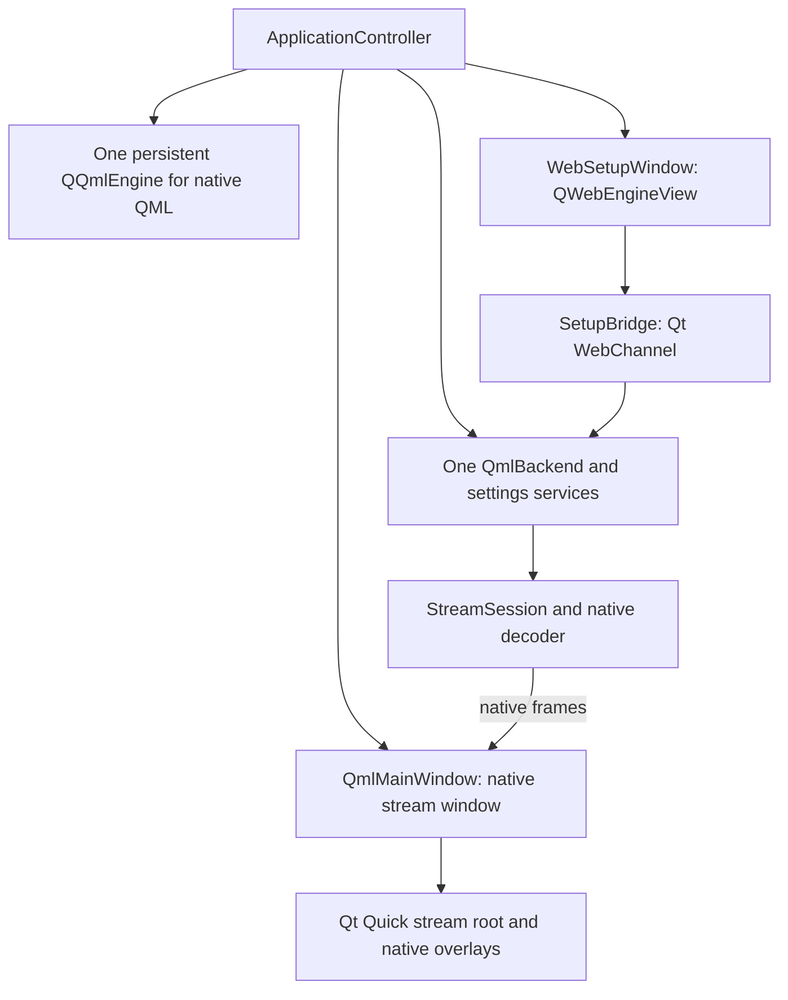

# Chiaki Recast UI migration plan

Historical reference, superseded by the current specification. The user
withdrew the QML setup fallback and dual-UI rollout proposals on 2026-10-22.
Use [the specification](spec.md) for current implementation requirements.

Status: needs-triage
Date: 2026-10-22
Scope: planning only. No application changes are part of this document.
Inspection base: `a25a0c96` plus the local changes present during inspection.

## Intended result

Use Svelte 5, TypeScript, HTML, and CSS for the desktop setup UI. Embed the
compiled frontend in a separate `QWebEngineView` window. Use Qt WebChannel
to call the existing native services.

Keep Remote Play video, audio, input, HDR, and overlays native. Open the native
stream window when a connection needs it. Hide the setup window after the
native window can show progress and accept input. Restore the setup window
after native cleanup finishes.

Make each migration stage usable and reversible. Keep the QML setup UI until
the web UI has feature parity on the supported release targets. Keep QML for
the native stream interface after the setup migration is complete.

This proposal changes the setup technology selected in the earlier
[console library spec](../ui-refresh/spec.md) and
[settings spec](../settings-refresh/spec.md). It retains their selected designs
and behavior. It does not replace
[ADR 0001, stream input ownership](../../docs/adr/0001-stream-input-ownership.md).

## Required boundaries

- Keep FFmpeg, libplacebo, decoder selection, frame queues, and native rendering.
- Keep controller input, keyboard and mouse mapping, gameplay capture, audio,
  microphone input, haptics, and touch input native.
- Keep the stream menu, statistics, notices, disconnect dialog, console login
  PIN prompt, and settings opened during a stream native.
- Keep existing settings keys, profiles, registrations, and stored credentials.
- Use the same native settings services from both interfaces.
- Send setup state and commands through WebChannel. Never send frames, decoded
  audio, raw controller events, or GPU handles through the bridge.
- Require Windows, Linux, and macOS release checks. Check each CPU architecture
  and toolchain separately before it receives the web UI by default.
- Do not add Electron, a web video player, a runtime Node server, or a new
  streaming backend.

## Current code and consequences

The following findings come from the current working tree. Recheck this table
before implementation if another change updates these files.

| Current code | Migration consequence |
| --- | --- |
| [`main.cpp`](../../gui/src/main.cpp) already creates `QApplication`. `RunMain` and `RunStream` each construct `QmlMainWindow`. | Keep one application and event loop. Select the setup UI in `RunMain`. Keep the direct `stream` command native. |
| [`QmlMainWindow`](../../gui/src/qmlmainwindow.cpp) is a `QWindow`. It creates the libplacebo renderer, a render-controlled `QQuickWindow`, a `QQmlEngine`, and `QmlBackend`. | It is more than an application shell. Retain its renderer and input code as the native stream window. Separate backend ownership before the web window uses it. |
| [`QmlBackend`](../../gui/src/qmlbackend.cpp) has the stream window as its QObject parent. Its constructor registers the `Chiaki` QML singleton. | A second window cannot safely create a second independent backend. Use one application-owned backend and register its QML interface once. |
| `QmlBackend::createSession` reads renderer information and the Vulkan hardware device context. Its frame callback calls `window->presentFrame`. | Prepare and attach the native renderer before session creation. Window destruction must wait for the session and frame callbacks. |
| `QmlBackend::sessionChanged` can report the same session at several connection stages. `connectionAttempt` has separate progress and cleanup state. | Do not treat each signal as a new session. Use the native attempt identity and phase for lifecycle decisions. |
| [`Main.qml`](../../gui/src/qml/Main.qml) supplies both setup navigation and stream navigation. [`StreamView.qml`](../../gui/src/qml/StreamView.qml) calls functions on its `root` navigation object. | Create a native stream root with the required navigation functions. Moving `StreamView.qml` alone would lose dialogs and settings routes. |
| `QmlMainWindow::show` creates the QML root and restores setup geometry each time it runs. | Separate root creation from window presentation. Restore an existing window without creating another root or applying setup geometry to playback. |
| [`QmlSettings`](../../gui/include/qmlsettings.h) exposes settings, file actions, and readable PSN tokens. `profileChanged` can replace the `Settings` instance. | Reuse settings logic through a restricted bridge. Do not publish all of `QmlSettings` or keep old settings pointers in the web adapter. |
| Registration, PSN authentication, and Steam shortcut methods include `QJSValue` callbacks. | Add native result signals or methods that the two UI adapters can share. A WebChannel completion callback is not a replacement for a backend `QJSValue`. |
| [`PSNLoginDialog.qml`](../../gui/src/qml/PSNLoginDialog.qml) implements public Account ID lookup in JavaScript. | Include this request, its timeout, response validation, and stale-result checks in the inventory. Move it to a shared native service when this screen migrates. |
| [`gui/CMakeLists.txt`](../../gui/CMakeLists.txt) finds optional `WebEngineQuick`. | Add `WebEngineWidgets` and `WebChannel` for the web setup build. Keep the existing Quick module while legacy PSN pages need it. |
| [`gui/prototype`](../../gui/prototype/README.md) contains simulated browser screens. | Reuse selected layouts, CSS values, and existing artwork. Do not ship the simulated actions or prototype data. |
| [`gui/tests`](../../gui/tests/CMakeLists.txt) has QML screen tests and native input tests. | Retain stream tests. Add checks that use an actual WebEngine page and the production bridge. |

## Proposed ownership

The following class names are proposed names. They do not exist yet.

`ApplicationController` owns application lifetime, the selected setup window,
the native stream window, and the native QML engine. It handles window
transitions and application exit. It does not implement discovery, connection,
or rendering logic.

Keep `QmlBackend` as the shared backend during the migration. Change its QObject
ownership from the stream window to the application controller. Add explicit
stream-window attachment and detachment. Do not rename the whole backend or
split every service as part of this change.

Keep session creation, connection attempts, PSN workers, discovery, and
registration in the existing native code. Give renderer-dependent operations
an attached native window. Define behavior for setup operations when no stream
window exists. Replace unconditional window calls in profile changes,
connection failures, app activity, and geometry handling.

Derive application activity from the active setup, stream, or owned dialog
window. A hidden stream window must not disable setup controller navigation.
Keep setup geometry and stream geometry separate, using the existing settings
keys. Preserve saved values when either window is absent.

`QmlMainWindow` keeps its render and input resources. Its backend reference
becomes non-owning. Preserve `getBackend()` for renderer helpers and update
its constructor callers and native test fixtures. Register the QML singleton
once before the engine loads it.

Move the existing `QQmlEngine` to application ownership. Use that one persistent
engine for the QML fallback setup root and native stream roots. The singleton
instance pattern permits only one accessing engine. Keep the backend and engine
on the same thread, and destroy the engine before the backend. These restrictions
follow the [Qt singleton rules](https://doc.qt.io/qt-6/qml-singleton.html#exposing-an-existing-object-as-a-singleton).
Do not create a new singleton or engine for each stream window.

Keep image providers with the engine. Update its incubation controller when the
associated render-controlled window changes. Destroy window-specific QML roots
and their signal connections with each window. Test window recreation without
retaining old render objects or input owners.

Audit the current `window` QML property, which is `CONSTANT`. An attachable window
needs a notified property or a fixed reference supplied to each stream root.
Keep that adaptation inside the native UI. Do not expose a window pointer to
the web page.

Give each QML root an explicit host-window reference. Adapt the fallback setup
root as well as the stream root. A fallback setup window must not replace the
backend's attached stream window or receive stream frames.

`Settings` remains the persistent store. `QmlSettings` keeps its existing
conversion and notification behavior. Route web writes through validated native
setters. When a profile change replaces `Settings`, refresh both UI adapters
and detach signals from the old instance before it is removed.

Extract a `NativeStreamRoot.qml` from the stream-related parts of `Main.qml`.
Retain the menu, PIN host, notices, error handling, renderer fallback dialog,
and stream settings routes. Preserve the `present`, `dismiss`, and `settled`
input lifecycle from ADR 0001. Passive notices must remain passive.

## Window and session lifecycle

The table describes application window states. It does not replace the existing
connection state machine. The native backend remains the source of connection
progress, cancellation rules, retry rules, and PSN cleanup state.

| Event or state | Setup window | Native stream window | Required behavior |
| --- | --- | --- | --- |
| Normal startup | Visible | Absent | Load native state before enabling commands. Start discovery and auto-connect with the existing rules. |
| Accepted connection | Visible until handoff | Prepare renderer and native root | Reject a second connection. Attach the window before `createSession` uses renderer resources. |
| Native handoff | Hide after native exposure succeeds | Visible with native progress or PIN prompt | Release setup input. Move focus once. Do not wait for a first frame to create the renderer. |
| Stream ready | Hidden | Visible | Use the existing ready condition, including the video-disabled route. Keep the entire media and input path native. |
| Stop, cancel, or connection failure | Hidden during cleanup, unless handoff never completed | Remains alive during native cleanup | Preserve disconnect policy, pending PSN cleanup, error state, and held-input release. |
| Cleanup complete | Restore and refresh | Close and destroy safely | Restore the console selection and focus. Show a retained error once when required. |
| Setup renderer crash | Show native recovery UI | Unaffected if active | Recreate the setup page or offer QML recovery. Do not stop a stream because Chromium failed. |
| Direct `stream` command | Never construct a setup page | Native only | Preserve launch options and exit behavior. Do not create a hidden web window. |

Registration-only PSN operations must remain setup operations. Do not hide the
setup UI merely because an internal registration operation creates a session
object. Prepare native resources only where the existing backend requires them.

Preserve `--exit-app-on-stream-exit`, fullscreen, zoom, stretch, saved geometry,
auto-connect cancellation, wake-up, suspend, and resume. Define close handling
for both windows. Closing a stream window follows the existing disconnect
policy. Closing the setup window during a connection must resolve that attempt
before application shutdown.

Control quit-on-last-window behavior explicitly during handoff. There can be a
short period with no visible window. Restore automatic exit only through the
application controller's exit path. Do not let a hidden page call `window.close`
and terminate native playback.

Treat a null `session` property as a state update, not proof of destruction.
The current code uses `deleteLater()`. Before destroying the stream window:

1. Release gameplay capture and held inputs.
2. Stop new frame delivery and cancel or finish the current connection work.
3. Wait for session cleanup and pending frame work to finish.
4. Free queued frames, including frames in callbacks that will never execute.
5. Release decoder references before the GPU resources they use.
6. Destroy swapchains and native overlay resources on their required threads.
7. Detach and destroy the window, then restore the setup UI.

Preserve the existing renderer teardown order where it already implements these
rules. Add an explicit completion signal if the current cleanup state does not
cover resource destruction. Use lifetime-safe references in queued callbacks.

### Chromium resource policy

Start with a hidden setup window. Stop UI animation and unnecessary updates
during playback. Freeze the hidden page where supported by the selected Qt
version. Reactivate it and read a fresh native snapshot before restoring it.
Qt exposes active, frozen, and discarded page states through
[`QWebEnginePage`](https://doc.qt.io/archives/qt-6.9/qwebenginepage.html#LifecycleState-enum).

Measure this policy before adding page destruction. Hiding or freezing a page
does not prove that Chromium GPU use or memory use is zero. If measurements
require page destruction, first define recovery of the route, console selection,
and unfinished non-secret forms. Do not retain PINs or sign-in redirect URLs.

Keep the page, channel, and bridge lifetime explicit. A page does not own the
channel installed with
[`setWebChannel`](https://doc.qt.io/archives/qt-6.9/qwebenginepage.html#setWebChannel).
Recreating the page must not recreate the native backend or restart a request.

## WebChannel contract

Publish one `SetupBridge` object. Publish only setup data and commands that the
current screen needs. Keep the native backend and its child QObjects private.
Use `QWebEnginePage::setWebChannel` and its built-in transport. A separate HTTP
API, WebSocket server, or network listener is unnecessary.

Use JSON-compatible maps, lists, strings, numbers, and booleans. Treat calls as
asynchronous. Qt caches properties in JavaScript, so a local property write is
not proof that a native operation succeeded. This follows the
[WebChannel JavaScript API](https://doc.qt.io/archives/qt-6.9/qtwebchannel-javascript.html).

Use a small TypeScript adapter to convert WebChannel callbacks to promises and
subscribe to native changes. Keep connection logic out of the adapter. Disconnect
subscriptions when a page is replaced. Read current state after initialization
and after resume. Do not depend on events that the page missed while absent.

| Contract area | Data or commands | Native rule |
| --- | --- | --- |
| Initial state | Capabilities, console list, profile identity, safe settings, current attempts | Subscribe and obtain current state without losing an update during startup. |
| Console actions | Connect, wake up, add manual host, hide, unhide, delete, edit saved console login PIN | Resolve the intended target again when the command arrives. Preserve existing confirmations. |
| Connection | Current attempt, retry, cancel, dismiss | Retain native attempt IDs, phase values, and cancellation limits. |
| Registration | Validated fields, registration context, progress, result, diagnostics | Retain context and profile checks. Distinguish dismissal from cancellation. |
| PSN | Sign-in status, permitted sign-in URL, redirect submission, Account ID lookup | Keep tokens and token exchange native. Reject stale results after profile changes. |
| Settings | Explicit safe reads, validated writes, result notifications | Preserve key names, units, ranges, conditions, and native side effects. |
| Native actions | File dialogs, log access, controller mapping, Steam shortcuts | Retain native services and error handling. Report completion separately from acceptance. |

Use an opaque console key scoped to the current profile. Derive target selection
from the existing `ConsoleLibrary.identityOf` and backend target checks.
Do not send a row index as a durable target. Discovery can reorder rows between
the user's click and command execution. Reject missing or ambiguous targets.
Resolve a valid key to the current backend index immediately before dispatch.

Keep native attempt and profile identities as strings where needed. Do not
convert a 64-bit counter to a JavaScript number. Include the relevant attempt
identity in results. Distinguish command acceptance from operation success.
Prevent repeated activation from starting duplicate work.

Replace callback-dependent native operations with signal-based completion only
where the bridge requires it. Keep a QML adapter for the existing callers.
Preserve validation, logs, timeout behavior, cancellation limits, and stale-result
checks. Do not copy those rules into Svelte.

### Trusted content and credentials

Load only packaged application content in the page that receives the bridge.
Use a separate browser page or the existing external browser route for PSN
sign-in. That page must have no setup bridge. Preserve the current embedded
sign-in option, cookie policy, and external redirect fallback during migration.

Do not publish raw `QmlSettings`, PSN tokens, registration keys, session keys,
or saved PINs. Publish status and masked values where the UI needs them. Accept
new secret values through specific native commands. Clear temporary secrets
after submission or dismissal. Keep them out of browser storage and logs.

Preserve streamer mode across console cards, details, profile names, account
fields, paths, errors, and diagnostics. Treat console names and service replies
as untrusted text. Do not render them with Svelte `{@html}`.

Block external navigation, remote frames, popups, downloads, and unexpected
resource requests in the trusted setup page. Open permitted help links through
a native action. Use a restrictive Content Security Policy. Keep the Chromium
sandbox enabled. Release packages must not depend on a development server or
enable remote debugging.

## Frontend structure and design

Create `gui/web` for production frontend sources. Use Svelte 5, TypeScript, and
Vite. Keep the result a static application. Svelte supports
[TypeScript in components](https://svelte.dev/docs/svelte/typescript), and Vite
produces a [static production bundle](https://vite.dev/guide/build.html).

Start with the components required by the first screen. The expected groups are:

- An application shell with navigation and status.
- Console library, console card, console details, and console action menu.
- Registration, manual host entry, PSN sign-in, and result forms.
- Settings navigation, search, field groups, and native action controls.
- Shared buttons, form fields, confirmation dialogs, and progress messages.

Use CSS variables for color, spacing, typography, borders, and focus indicators.
Use Grid for the card library and main page regions. Use Flexbox for control
rows. Use CSS for transitions and honor reduced motion. Keep JavaScript for
state and interaction.

Use the selected card library, category sidebar, and guided workspace designs
from the existing prototypes and production QML. Reuse console artwork from
`gui/res`. `image://svg` is a QML provider URL, so package the original assets
or equivalent SVG resources for the browser. Keep prototype scripts and sample
settings out of the release bundle.

Use native HTML controls unless the existing visual or interaction rules need
a component. Preserve labels, visible focus, keyboard operation, controller
navigation, touch operation, dialog focus return, and screen-reader names.
Keep controller discovery and device access native. Test a single active source
for setup navigation so native input and browser Gamepad events cannot both
activate an action.

Keep the established 900 by 600 and 1280 by 720 setup checks. Add narrow reflow,
long names, empty results, display scaling, and 200 percent zoom checks. Permit
vertical scrolling. Do not hide actions to make a layout fit. Narrow reflow
does not add Android or iOS support.

Keep the existing translated text and translation behavior in the inventory.
Choose the web message catalog mechanism when the first screen migrates. Avoid
adding a translation framework before the catalog requirements are known.

## Feature parity inventory

Complete this inventory before removing a QML setup route. Each row needs a
native source, web implementation, automated checks, and an acceptance record.

| Feature group | Behavior to preserve | Existing sources |
| --- | --- | --- |
| Console library | Discovery, search, local and PSN consoles, selection, wake-up, details, hidden consoles, deletion, saved console login PIN, privacy | `ConsoleLibrary.qml`, `ConsoleDetails.qml`, `QmlBackend::hosts` and console actions |
| Connection setup | Wake wait, auto-connect, local and remote progress, retry, cancellation limits, stale targets, error recovery | `AutoConnectView.qml`, `ConnectionView.qml`, `PsnView.qml`, native attempt state |
| Registration | Console firmware choices, Remote Play pairing code, console login PIN, account source, broadcast, duplicate prevention, progress and results | `RegistDialog.qml`, `RegistrationMethodDialog.qml`, `QmlBackend::registerHost` |
| Manual hosts | Address validation, existing registration choice, save result, later registration | `ManualHostDialog.qml`, native host actions |
| PSN | Embedded and external sign-in, sign-in redirect URL, public Account ID lookup, expired credentials, refresh, profile invalidation | `PSNTokenDialog.qml`, `PSNLoginDialog.qml`, `PSNAccountID`, `PSNToken` |
| Settings | All categories, search routes, separate local and remote PS4 and PS5 values, audio devices, capability-dependent controls | `SettingsDialog.qml`, `SettingsSearch.js`, `QmlSettings`, `Settings` |
| Advanced settings | Display targets, renderer options, color mapping, decoder and renderer choices, restart requirements | `DisplaySettingsDialog.qml`, `PlaceboSettingsDialog.qml`, `PlaceboColorMappingDialog.qml` |
| Input setup | Key capture, keyboard and mouse bindings, conflict handling, mouse response, reset behavior, controller mapping and device changes | `KeyboardMousePage.qml`, `MouseResponsePane.qml`, `ControllerMappingDialog.qml`, native input services |
| Profiles and files | Create, switch, delete, import, export, renderer settings files, log directory and access | `ProfileDialog.qml`, `QmlSettings` file methods, `Settings` |
| Remaining setup actions | Startup reminders, confirmations, Steam shortcuts, supported folder selection and documentation links | `RemindDialog.qml`, `ConfirmDialog.qml`, `SteamShortcutDialog.qml`, backend actions |
| Native stream interface | Menu, statistics, passive and action notices, disconnect policy, console login PIN, live settings, focus and held-input release | `StreamView.qml`, related stream components, `StreamInputOwnership`, ADR 0001 |

Keep the existing QML input capture or mapping dialog available during the
intermediate stages if its web replacement is not ready. Before setup parity
is declared, provide the equivalent web flow with native capture, or record
an explicit exception. Live stream settings remain native by design.

## Build, assets, and release support

Add `CHIAKI_GUI_ENABLE_WEB_UI`, initially off. When enabled, require matching
Qt `WebEngineWidgets` and `WebChannel` modules. `QWebEngineView` belongs to
[`WebEngineWidgets`](https://doc.qt.io/archives/qt-6.9/qwebengineview.html).
The existing `CHIAKI_HAVE_WEBENGINE` describes Quick support and must not silently
become the new widget feature flag.

Add a runtime selector, proposed as `--ui=qml|web`, for validation and recovery
in builds that include both interfaces. Reject an unavailable selection with a
clear message. Do not require Node or WebEngineWidgets in a QML-only build.
Document that missing linked Qt libraries can prevent the executable from
starting. An in-process runtime fallback cannot repair that package error.

Build with a pinned Node toolchain and package lock. Use `npm ci`, type checks,
frontend tests, and a production build in CI. Pin Svelte 5 and a compatible Vite
release after checking the chosen Node and embedded Chromium versions. Do not
assume that the Vite default browser target matches every Qt package.

Use `base: './'` for packaged relative asset URLs. Vite supports this
[relative base configuration](https://vite.dev/guide/build.html#relative-base).
First prove that the production bundle, dynamic imports, fonts, artwork, and
`qwebchannel.js` load from a `qrc` URL in the chosen Qt build. Use a custom
application scheme only if this check requires one. In that case, register it
before `QApplication`, serve only embedded resources, and grant only the flags
needed by the bundle. See
[`QWebEngineUrlScheme`](https://doc.qt.io/archives/qt-6.9/qwebengineurlscheme.html).

Make frontend compilation a CMake build dependency when the feature is enabled.
Embed the complete output, including content-hashed assets, in a separate Qt
resource collection. Generate its file list during the build. A clean build
must not depend on an old `dist` directory or downloaded runtime files.
Rebuild resources when frontend files or the lockfile change.

| Release target | Existing integration to inspect | Required gate |
| --- | --- | --- |
| Windows x64 with MSVC | `build-windows-x86.yml` already installs Qt WebEngine and WebChannel and uses `windeployqt` | Deploy the widget module, helper process, resources, locales, and required runtime libraries. Test a machine without a Qt SDK. |
| Windows ARM64 | `build-windows-arm.yml` and `build-windows-arm-portable.yml` omit Qt WebEngine from their module lists | Prove module availability for the selected Qt release and architecture. Keep the QML build until a real package passes. |
| Windows MSYS2 and MinGW | `build-msys2.yml`, related variants, and `deploy-windows-msys2.sh` | Keep QML support. Do not assume the MSVC WebEngine package can be used with MinGW. |
| Linux AppImage | `build-appimage-*.yml`, `build-appimage.sh`, compatibility and launcher scripts | Check helper and resource paths, sandbox operation, X11, Wayland, and the oldest supported runtime. |
| Linux Flatpak | `scripts/flatpak/*.yaml` already uses a Qt WebEngine BaseApp | Check the widget module and matching BaseApp, helper path, sandbox, file dialogs, and gamescope handoff. |
| macOS Intel and Apple silicon | `build-macos-*.yml` and existing `macdeployqt` steps | Check widget deployment, helper signing, entitlements, notarization, window activation, and native microphone behavior. |

Qt 6.9 documents that WebEngine does not compile with MinGW. This is a toolchain
constraint, not proof about every newer Qt release. Recheck the selected release
before changing this target. See
[Qt WebEngine platform notes](https://doc.qt.io/archives/qt-6.9/qtwebengine-platform-notes.html#windows).

Package WebEngine helper files, resources, locales, and dependency notices.
On macOS, check helper signing and entitlements. The Qt deployment guide explains
these [WebEngine package requirements](https://doc.qt.io/archives/qt-6.9/qtwebengine-deploying.html).
Keep Qt and Chromium security updates within the project's release process.

## Ordered implementation work

These are work packages for a later implementation. They are not implementation
claims. Create separate issue files when implementation starts.

| ID | Work package | Depends on | Complete when |
| --- | --- | --- | --- |
| 00 | Record the feature inventory and native performance baseline. Check module availability and packaged Svelte loading. Test WebEngine with the native OpenGL and Vulkan paths. | None | A compatibility report names the tested Qt version, toolchains, GPU paths, package results, and unsupported combinations. |
| 01 | Add application and shared QML engine ownership, then explicit native-window attachment. Keep the QML setup UI as the only production UI. Audit every constructor, window call, close path, settings replacement, and worker shutdown. | 00 | The existing UI can connect, stop, reconnect, change profiles, and use direct streaming without behavior changes. Window teardown checks pass. |
| 02 | Extract the native stream root and implement setup-to-stream handoff with the QML setup path. Preserve all native overlay and input lifecycles. | 01 | Native playback opens separately and returns correctly. Failures, PIN prompts, live settings, close, suspend, and resume pass. |
| 03 | Add the optional web build, packaged setup page, restricted bridge, initial snapshot, capability data, and stable console targets. | 00, 02 | An actual WebEngine page can show live discovery, call native actions, recover after reload, and reject stale targets. QML-only builds still pass. |
| 04 | Migrate the console library and a registered local connection. Reuse the native connection progress and PIN UI after handoff. | 03 | A real console can wake, connect, stream, disconnect, and reconnect. Errors restore the setup UI and its selection. |
| 05 | Migrate registration, manual hosts, PSN sign-in, public Account ID lookup, and remote setup. Adapt callback-based APIs. | 04 | Local and PSN flows pass with real results. Profile changes, expired credentials, timeouts, dismissal, retry, and stale replies are covered. |
| 06 | Migrate settings in category groups. Include advanced pages, profiles, files, input capture, controller mapping, reminders, and Steam shortcuts. | 05 | Every setup inventory item has an equivalent flow and the same persistent value and native side effects. |
| 07 | Validate resource use and release packages on each supported target. Add page destruction only if measurements require it. | 04 for early checks, 06 for final acceptance | Packaged applications pass lifecycle, accessibility, input, graphics, and performance checks. Chromium resource policy has measured evidence. |
| 08 | Enable web setup by default on validated targets. Retain the documented QML recovery path during an initial release period. | 07 | The release matrix has no unrecorded feature loss or performance failure. Recovery instructions work in installed packages. |
| 09 | Remove unused QML setup routes and obsolete callback adapters after the release period. | 08 and release evidence | No remaining caller needs the removed code. Native stream QML, live settings, supported fallback builds, and their tests remain. |

Run packaging checks as soon as work package 03 exists. Do not wait for all
screens to migrate before testing release artifacts.

Work package 00 must test the graphics initialization order. The current native
window selects the Qt Quick graphics API and supplies its own graphics device.
WebEngine creation can introduce another graphics user in the same process.
The existence of separate windows does not prove compatibility or isolation.

If the selected Qt and renderer combination fails, stop the default rollout.
Keep the QML path while the cause is tested. Consider a process boundary only
if evidence shows that the in-process architecture cannot meet the requirement.
Do not add another process and protocol as an untested precaution.

## Verification and acceptance

Use three test boundaries. Frontend fixtures check presentation and interaction.
Native tests check validation and lifecycle. Embedded integration tests check
the actual WebEngine-to-native command path. Browser mocks alone cannot prove
WebChannel behavior, decoder setup, HDR, native focus, or release packaging.

| Area | Required checks |
| --- | --- |
| Bridge | Initial state, native changes, command results, rejected invalid values, target reorder, ambiguous targets, repeated activation, stale attempt and profile IDs, reload during a pending request |
| Lifecycle | Connection success, initialization failure, early cancellation, late PSN cancellation, disconnect confirmation, console sleep, network failure, repeated sessions, setup page crash, native close, full application exit |
| Settings | Read and write through both UIs, restart and reload, profile replacement, import and export failures, native file dialogs, unavailable devices, platform conditions, local and remote values, restart-only changes |
| Native input | Overlapping input owners, obsolete callbacks, owner destruction, PIN prompts, menu close, live settings, held keys and buttons, gameplay capture, focus return, controller disconnect |
| Layout and access | Required window sizes, scaling, 200 percent zoom, long names, empty states, keyboard, controller, touch, screen-reader labels, reduced motion, focus restoration |
| Trusted content | External navigation and subframe rejection, untrusted names, public lookup response validation, no bridge on sign-in pages, no secrets in snapshots, browser storage, or logs |
| Package | Clean install without developer tools, offline setup assets, helper startup, locale files, sandbox, supported display systems, both UI selectors, direct stream launch |

Keep the existing `chiaki-console-screen-tests`, `chiaki-stream-input-tests`,
and applicable native input targets as regression checks. The native input
targets are currently conditional on a GNU compiler in `gui/tests/CMakeLists.txt`.
Use the supported toolchain or add equivalent native coverage before claiming
that an MSVC-only test run proves native input parity.

Record frontend test and type-check commands in `gui/web/README.md` when that
directory exists. Add integration targets to CTest with a documented display
requirement. Run native GPU acceptance on a real desktop. An offscreen software
render test does not prove the stream renderer path.

### Performance gate

Compare the current QML application with the migrated application on the same
machine, console, network, decoder, renderer, stream profile, and display mode.
Measure at least three repeated steady-state runs for each comparison. Include
both OpenGL and Vulkan where available, SDR, supported HDR modes, and hardware
decode. Include a software decode case and a decoder fallback case.

Record frame timing, queue depth, pending frame age, dropped frames, audio
underruns, CPU use, GPU use, and process memory. Include Chromium helper processes
in resource measurements. Record connection-to-first-frame time separately.
Use existing native statistics where possible. Record the measurement limits.

Compare end-to-end input latency with an external measurement method where
available. Frame statistics alone cannot prove unchanged input latency. If the
measurement equipment is unavailable, retain that acceptance item as unverified.

Require no repeatable streaming regression beyond the measured variation in
the native baseline. Establish numerical tolerances from work package 00 before
evaluating the migrated build. Do not select tolerances after seeing a failure.
Report setup startup time, package size, and idle memory separately, since those
can change even when stream performance remains stable.

Use representative runs long enough to expose resource growth and thermal
effects. Include at least one 30-minute stream and 20 connect-stop cycles per
validated renderer path. Inspect leaked windows, callbacks, threads, GPU objects,
held inputs, and helper processes after the cycles.

## Risks and decisions still to verify

| Risk or decision | Required evidence |
| --- | --- |
| Window separation changes backend and GPU lifetime | Native teardown and repeated-session checks, including queued frames and PSN workers |
| Qt Quick and Chromium affect the same process | Graphics compatibility and streaming measurements from work package 00 |
| Hidden Chromium retains resources | Whole-process measurements for hidden, frozen, and, if needed, destroyed pages |
| Web UI support differs between release targets | Actual Qt module and package checks for each architecture and toolchain |
| WebChannel changes callback timing | Embedded tests with delayed results, cancellation, reload, and profile changes |
| Settings or credentials diverge between interfaces | Same-store round trips, profile changes, restarts, and secret inspection |
| Input behavior changes at handoff | Real desktop checks plus ADR 0001 regression tests |
| Native settings remain available during playback | Stream-root navigation and input-owner checks for each live settings route |
| Existing prototype behavior is incomplete | Production feature inventory with real backend results |

Write a new architecture decision record after work package 00 confirms the
selected embedding and ownership approach. Add glossary terms only when their
meaning is settled. Do not mark the architecture as validated from this plan.

## Completion criteria

The migration is complete when the web setup UI has feature parity on its
declared release targets, the native stream interface remains intact, and the
release packages pass the acceptance checks. Any target that retains QML must
be named in the release matrix with the reason.

This planning task does not run builds, browser tests, native session tests,
hardware measurements, or package validation. Its evidence is source inspection
and the linked primary documentation. The first implementation task is work
package 00.
